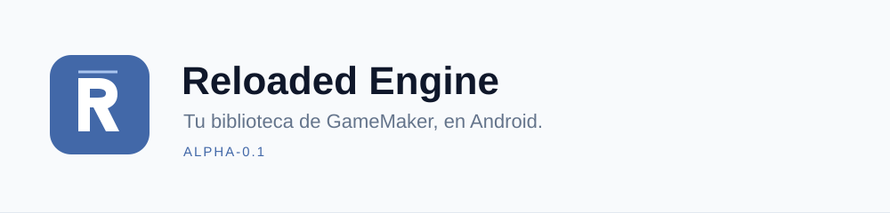
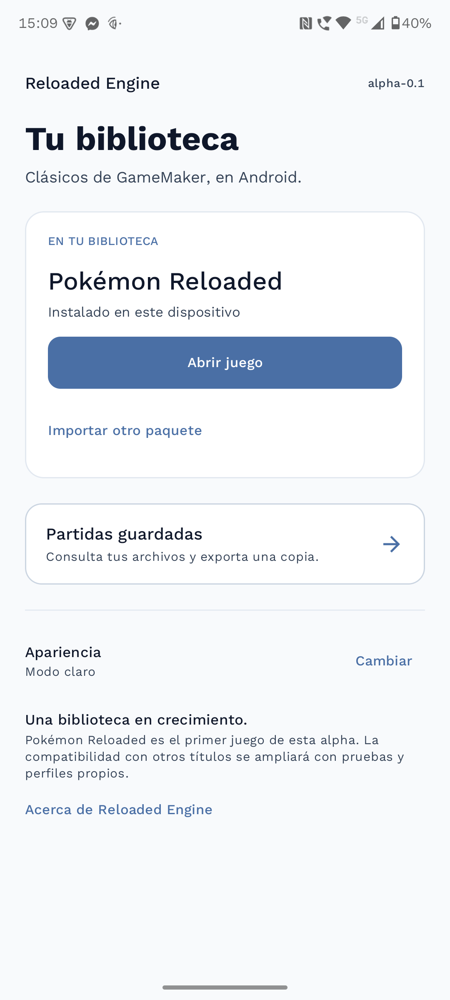
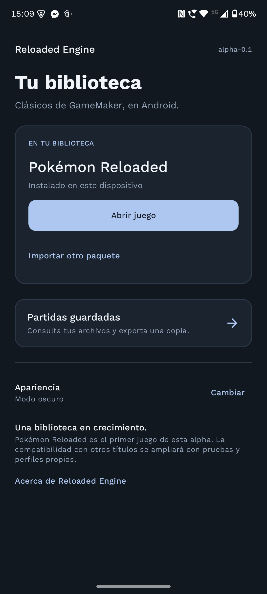

<p align="center">
  
</p>

<p align="center">
  <a href="https://github.com/FxxMorgan/Reloaded-Engine/releases/tag/alpha-0.1">Descargar alpha</a> ·
  <a href="#primeros-pasos">Primeros pasos</a> ·
  <a href="#compatibilidad">Compatibilidad</a> ·
  <a href="#compilar">Compilar</a> ·
  <a href="ROADMAP.md">Roadmap</a> ·
  <a href="#agradecimientos">Agradecimientos</a>
</p>

**Reloaded Engine** es un launcher independiente para ejecutar juegos de GameMaker 8 en Android, con una interfaz sencilla, controles táctiles y un motor basado en OpenGMK.

**Pokémon Reloaded es el primer juego compatible.**

Es el punto de partida de una biblioteca más amplia: cada nuevo título necesitará su propio trabajo de compatibilidad y pruebas.
La alpha actual mantiene una sola instalación de juego.

> **alpha-0.1 · Alpha pública experimental.** Queremos recopilar experiencias en más dispositivos y gamepads. La compatibilidad comprobada se limita al juego y dispositivo descritos abajo. [Cuéntanos cómo funciona](https://github.com/FxxMorgan/Reloaded-Engine/issues/new/choose).

<p align="center">
  
  &nbsp;
  
</p>

## Qué incluye

- Importación del paquete ZIP del juego y reapertura de la instalación sin depender del ZIP temporal.
- Controles táctiles con distribución editable y **soporte de gamepad Bluetooth/USB**, con cruceta, stick izquierdo y botones físicos.
- Velocidad normal y opción 2×. El modo 4× se retiró tras encontrar bloqueos.
- Portada en vertical y juego en horizontal, con temas claro y oscuro.
- Consulta de archivos de partida, copias locales y exportación de todos sus componentes en un ZIP.
- Panel de diagnóstico opcional; permanece oculto al comenzar una partida.

El APK contiene el launcher y su motor. **Los juegos y sus recursos se obtienen por separado.** Este proyecto no es una publicación oficial de Pokémon Reloaded ni de F3R Productions.

## Primeros pasos

1. Descarga e instala el **APK ARM64 firmado** de [alpha-0.1](https://github.com/FxxMorgan/Reloaded-Engine/releases/tag/alpha-0.1).
2. Abre la app y selecciona **Importar paquete ZIP**.
3. Elige tu paquete completo de Pokémon Reloaded: debe incluir el ejecutable `.exe` y su carpeta `data`, manteniendo la estructura original.
4. Espera a que termine la importación y pulsa **Abrir juego**.
5. Guarda tu progreso desde el propio juego. En **Partidas guardadas**, usa **Exportar copia ZIP** para conservar una copia fuera de la app.

La importación necesita espacio para el ZIP temporal y los archivos extraídos. Antes de reemplazar el paquete se crea una copia local de las partidas existentes; los archivos de guardado ya presentes también se conservan durante la extracción.

Las copias locales permanecen dentro del almacenamiento de la aplicación. **Desinstalar la app las elimina.** El ZIP exportado incluye los archivos de `data/partidas`, entre ellos `.savc`, `.data`, `.nfo` y sus variantes de respaldo. La restauración de copias desde la interfaz queda pendiente.

Durante el juego, abre la flecha de la esquina para mostrar los controles del launcher: velocidad, pausa, distribución de botones y diagnóstico. Los botones Z, X, C y demás teclas virtuales siguen las asignaciones del juego.

## Jugar con gamepad

Conecta el mando por Bluetooth o USB antes o durante la partida. Cuando Android lo detecta como gamepad, los controles táctiles se ocultan automáticamente; reaparecen al desconectarlo. El modo de edición permite mostrarlos mientras ajustas su distribución.

| Control físico identificado por Android | Tecla enviada al juego |
| --- | --- |
| Cruceta o stick izquierdo | Flechas de dirección |
| A / B / X / Y | Z / X / C / A |
| L1 / R1 | S / D |
| Start / Select | Enter / Escape |
| L2 / R2, cuando se entregan como botones | Espacio / F1 |

La serigrafía varía entre marcas. El soporte utiliza los eventos estándar de Android; la detección y asignación necesitan validación con más modelos. Si tu mando funciona o algún botón falla, [abre un reporte de gamepad](https://github.com/FxxMorgan/Reloaded-Engine/issues/new?template=gamepad.yml).

## Compatibilidad

| Componente | Alcance de esta alpha |
| --- | --- |
| Plataforma distribuible | Android ARM64 (`arm64-v8a`) |
| Versión mínima declarada | Android 8.0 / API 26 |
| Gráficos | OpenGL ES 3.0 |
| Juego probado | Pokémon Reloaded 1.9.2.2 |
| Dispositivo probado | Motorola edge 40 |
| Otros juegos, dispositivos y plataformas | Sin validar |

Se verificaron la carga de partida, los cambios de sala y un combate completo. Tras corregir el cargador de sprites, el combate observado por logs avanzó cerca de 30 pasos por segundo; esto no garantiza el mismo rendimiento en otras escenas o dispositivos.

El barrido del paquete probado decodificó **26.237 archivos de sprites y 103.602 cuadros sin fallos**. Estas comprobaciones cubren el problema investigado, no una partida completa de principio a fin.

### Límites conocidos

- Pueden quedar funciones de GameMaker y situaciones del juego sin implementar o sin probar.
- El consumo de memoria y la estabilidad en sesiones largas necesitan más pruebas. Se observó un cierre por falta de memoria con la app en segundo plano durante el desarrollo.
- La reproducción MIDI aún no está verificada: hay un SoundFont empaquetado, pero falta conectar su carga al motor y ofrecer su configuración.
- La opción 2× depende de la capacidad del dispositivo y no se garantiza en todas las escenas.
- Los mandos físicos tienen soporte en el código; falta ampliar la validación con modelos reales.

## Compilar

El flujo de compilación utiliza Linux. Necesitas Android SDK 35, **NDK 28.2.13676358**, **JDK 21** y Rust con el target Android. Configura `JAVA_HOME` para usar ese JDK: la versión de lint incluida falla con el JDK 25 del entorno de desarrollo. Se utiliza Rust 1.99.1; no se ha establecido una versión mínima de Rust.

Obtén el código completo (OpenGMK está incluido, no requiere submódulos):

```bash
git clone https://github.com/FxxMorgan/Reloaded-Engine.git
cd Reloaded-Engine
```

Desde la raíz del proyecto:

```bash
export ANDROID_HOME="$HOME/Android/Sdk"
export ANDROID_NDK_HOME="$ANDROID_HOME/ndk/28.2.13676358"
rustup target add aarch64-linux-android

./scripts/build-native.sh
./gradlew assembleDebug
```

Si el SDK está en otra ubicación, configura también `sdk.dir` en tu archivo local `local.properties`. El script nativo termina con error cuando falla la compilación; Gradle debe ejecutarse después de generar la biblioteca actualizada.

| Resultado | Ruta |
| --- | --- |
| Biblioteca nativa ARM64 | `app/src/main/jniLibs/arm64-v8a/libreloaded_jni.so` |
| APK de desarrollo | `app/build/outputs/apk/debug/app-debug.apk` |
| APK release sin firmar | `app/build/outputs/apk/release/app-release-unsigned.apk` |

Para generar el último archivo, ejecuta `./gradlew assembleRelease`. **Un APK release sin firmar no se puede instalar.** Las releases públicas se firman automáticamente en GitHub Actions con una clave persistente, y `scripts/sign-apk.sh` permite firmar una compilación local. Consulta [el proceso de publicación](docs/publicacion.md).

El APK debug utiliza una clave diferente de las releases públicas y no se puede actualizar directamente con ellas. Exporta y conserva tus partidas antes de migrar de una compilación de desarrollo; desinstalar elimina los datos internos de la app.

```bash
adb install -r app/build/outputs/apk/debug/app-debug.apk
```

### Verificación

```bash
(cd native && cargo test --locked --workspace)
(cd native && cargo test --locked -p gm8emulator --lib sprite)
./gradlew testDebugUnitTest lintDebug
```

Los tests de exportación comprueban que todos los componentes del guardado conservan sus bytes dentro del ZIP. Las pruebas nativas cubren, entre otros casos, los sprites externos, la transparencia, la conservación de partidas durante una actualización y los errores de extracción.

El barrido completo de `--workspace` también ejecuta pruebas heredadas de OpenGMK: en el entorno Linux actual fallan siete comparaciones de precisión numérica (`op_add`, `arccos`, `exp`, `gt`, `lt`, `prec_19` y `tan`). Están pendientes de investigación; el conjunto completo todavía no está en verde.

## Organización

```text
app/                        Interfaz Android, audio y controles
native/reloaded-jni/         Integración JNI, superficie y ejecución del motor
native/reloaded-core/        Importación, estado y utilidades nativas
native/vendor/OpenGMK/       Runtime OpenGMK con adaptaciones de compatibilidad
scripts/                    Herramientas de compilación
docs/                       Notas de la alpha y recursos de documentación
```

La ejecución del juego utiliza el runtime de OpenGMK.
Las utilidades y pruebas auxiliares de `reloaded-core` no equivalen por sí solas a compatibilidad completa con GameMaker.

## Roadmap

El [roadmap](ROADMAP.md) pone primero las partidas **PC ↔ Android** en la misma versión del juego. Después aborda pantalla completa opcional, controles que cambian por contexto con diseños e iconos personalizables, dibujo más fluido sin acelerar la lógica y la biblioteca de varios juegos. Incluye criterios para comprobar cada fase y distingue los cambios en desarrollo del APK publicado.

Los [requisitos de experiencia y compatibilidad](docs/experiencia-y-compatibilidad.md) describen la prueba PC → Android → PC y las mejoras de pantalla, controles y FPS usando la implementación de Klisee como referencia.

La [revisión de issues de Klisee](docs/triage-klisee.md) contrasta 63 reportes abiertos con nuestra implementación. El primer parche preparado corrige la limpieza de teclas retenidas; su comprobación con mando físico y su inclusión en otro APK siguen pendientes.

El alcance de la versión publicada está descrito en [las notas de alpha-0.1](docs/alpha-0.1.md).

## Participar y comparar

Publica tu experiencia en [Issues](https://github.com/FxxMorgan/Reloaded-Engine/issues/new/choose), incluso si todo funciona. Hay formularios para errores, dispositivos, gamepads y propuestas. [CONTRIBUTING.md](CONTRIBUTING.md) explica qué datos incluir y cómo recoger logs.

La [comparación con Klisee](docs/comparacion-klisee.md) describe qué aporta esta integración, qué funciones comparten ambos proyectos y dónde el alcance de su aplicación es mayor. No hay un benchmark que demuestre superioridad de rendimiento o estabilidad.

## Agradecimientos

- **[OpenGMK](https://github.com/OpenGMK/OpenGMK)**, por el runtime libre de GameMaker 8 sobre el que se construye la ejecución de los juegos.
- **[Klisee](https://github.com/Klisee/pokemon-reloaded-android)**, por el concepto de llevar Pokémon Reloaded a Android y por las implementaciones y parches de compatibilidad que sirvieron como referencia y base de adaptaciones en este proyecto.
- **[F3R Productions y el equipo de Pokémon Reloaded](https://pokemon-reloaded.blogspot.com/)**, por crear el primer juego que nos ha permitido desarrollar y probar el launcher.
- **Tim Brechbill y David Bolton**, por el SoundFont TimGM6mb, incluido con sus avisos GPL-2.0.
- A quienes prueban las compilaciones, conservan logs y ayudan a encontrar errores en dispositivos reales.

Reloaded Engine integra trabajo propio con software y adaptaciones de terceros.
La procedencia de los cambios está detallada en [THIRD_PARTY_NOTICES.md](THIRD_PARTY_NOTICES.md).

## Licencia

El código del proyecto se distribuye bajo **GPL-2.0-only**; consulta [LICENSE](LICENSE). Los componentes de terceros conservan sus licencias y avisos respectivos. Esta licencia de software no concede derechos sobre los juegos, sus marcas o sus recursos.
